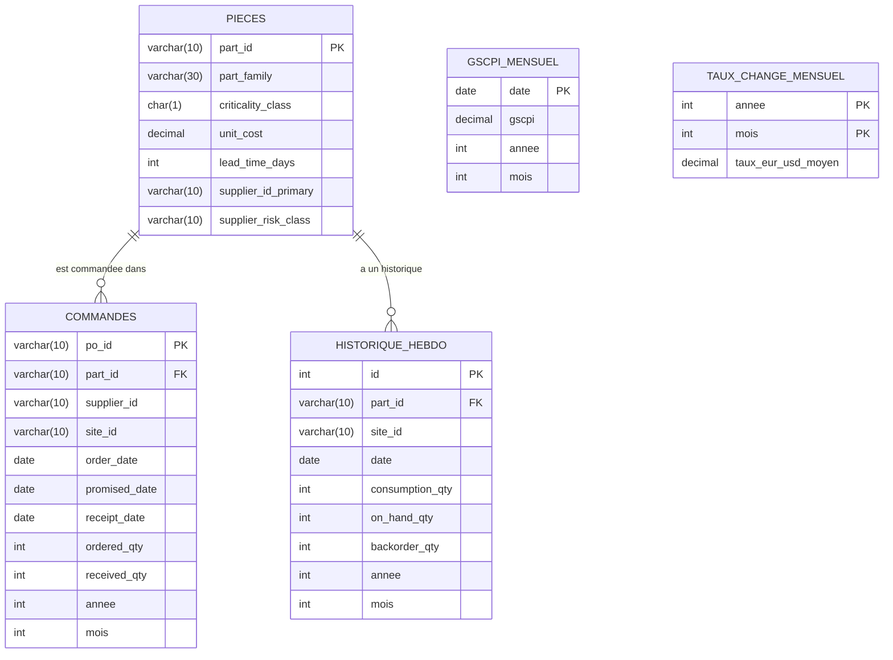

# Dictionnaire de données · base `airbus_supplychain`

Une ligne par colonne : son nom, son type, ses règles, ce qu'elle veut dire, et d'où elle vient.
Les schémas du modèle conceptuel (MCD) et du modèle physique (MPD) sont joints à ce document.

**Sources :** Kaggle « Aerospace Supply Chain Performance & Forecasting » (jeu de données **synthétique**, récupéré par l'API de Kaggle), indice GSCPI (Réserve fédérale de New York, fichier Excel) et API Frankfurter (taux de change EUR/USD, données de la Banque centrale européenne).

## Table `pieces` : une ligne par pièce (300 lignes)

| Colonne | Type | Règles | Signification | Source |
| --- | --- | --- | --- | --- |
| part_id | VARCHAR(10) | clé primaire | Numéro de la pièce | parts_master.csv |
| part_family | VARCHAR(30) | obligatoire | Famille de la pièce (Engine, Avionics, Cabin, Electrical, Fasteners, Hydraulics, LandingGear, Structure) | parts_master.csv |
| criticality_class | CHAR(1) | obligatoire, A, B ou C | Criticité : A = sécurité, B = opérationnelle, C = non critique | parts_master.csv |
| unit_cost | DECIMAL(12,2) | obligatoire, supérieur à 0 | Coût unitaire de la pièce (la monnaie n'est pas précisée par la source) | parts_master.csv |
| lead_time_days | INT | obligatoire, supérieur à 0 | Délai de livraison annoncé pour la pièce, en jours | parts_master.csv |
| supplier_id_primary | VARCHAR(10) | obligatoire | Fournisseur principal de la pièce (40 fournisseurs) | parts_master.csv |
| supplier_risk_class | VARCHAR(10) | obligatoire, Low, Medium ou High | Niveau de risque du fournisseur | parts_master.csv |

## Table `commandes` : une ligne par commande fournisseur (29 666 lignes)

| Colonne | Type | Règles | Signification | Source |
| --- | --- | --- | --- | --- |
| po_id | VARCHAR(10) | clé primaire | Numéro de la commande | purchase_orders.csv |
| part_id | VARCHAR(10) | obligatoire, clé étrangère vers pieces | Pièce commandée | purchase_orders.csv |
| supplier_id | VARCHAR(10) | obligatoire | Fournisseur de la commande | purchase_orders.csv |
| site_id | VARCHAR(10) | obligatoire | Site qui a passé la commande | purchase_orders.csv |
| order_date | DATE | obligatoire | Date de la commande | purchase_orders.csv |
| promised_date | DATE | obligatoire | Date de livraison promise | purchase_orders.csv |
| receipt_date | DATE | obligatoire | Date de réception réelle | purchase_orders.csv |
| ordered_qty | INT | obligatoire, supérieur à 0 | Quantité commandée | purchase_orders.csv |
| received_qty | INT | obligatoire, supérieur ou égal à 0 | Quantité reçue | purchase_orders.csv |
| annee | INT | obligatoire | Année de la commande | calculée à partir de order_date |
| mois | INT | obligatoire, entre 1 et 12 | Mois de la commande | calculée à partir de order_date |

Règles de la table : la réception ne peut pas précéder la commande (receipt_date supérieure ou égale à order_date), et on ne reçoit pas plus que ce qui est commandé (received_qty inférieure ou égale à ordered_qty).

## Table `historique_hebdo` : une ligne par site, pièce et semaine (280 800 lignes)

| Colonne | Type | Règles | Signification | Source |
| --- | --- | --- | --- | --- |
| id | INT | clé primaire, numéro automatique | Numéro attribué par MySQL, sans signification métier | créée par MySQL |
| part_id | VARCHAR(10) | obligatoire, clé étrangère vers pieces | Pièce concernée | supply_chain_history.csv |
| site_id | VARCHAR(10) | obligatoire | Site concerné (6 sites) | supply_chain_history.csv |
| date | DATE | obligatoire | Lundi de la semaine | supply_chain_history.csv |
| consumption_qty | INT | obligatoire, supérieur ou égal à 0 | Pièces utilisées dans la semaine (production et maintenance) | supply_chain_history.csv |
| on_hand_qty | INT | obligatoire, supérieur ou égal à 0 | Pièces en stock | supply_chain_history.csv |
| backorder_qty | INT | obligatoire, supérieur ou égal à 0 | Pièces demandées mais non livrées : signal de rupture | supply_chain_history.csv |
| annee | INT | obligatoire | Année de la semaine | calculée à partir de date |
| mois | INT | obligatoire, entre 1 et 12 | Mois de la semaine | calculée à partir de date |

Règles de la table : une seule ligne par site, pièce et semaine (UNIQUE sur site_id, part_id, date). Une semaine est rangée dans le mois de sa date (le lundi).

## Table `gscpi_mensuel` : une ligne par mois (une ligne par mois depuis janvier 1998)

| Colonne | Type | Règles | Signification | Source |
| --- | --- | --- | --- | --- |
| date | DATE | clé primaire | Fin du mois | gscpi_data.xls (New York Fed) |
| gscpi | DECIMAL(10,6) | obligatoire | Indice de pression sur les chaînes d'approvisionnement mondiales : 0 = niveau moyen, une valeur positive = plus de tensions | gscpi_data.xls (New York Fed) |
| annee | INT | obligatoire | Année du mois | calculée à partir de date |
| mois | INT | obligatoire, entre 1 et 12 | Mois | calculée à partir de date |

## Table `taux_change_mensuel` : une ligne par mois (36 lignes)

| Colonne | Type | Règles | Signification | Source |
| --- | --- | --- | --- | --- |
| annee | INT | clé primaire (avec mois) | Année | calculée à partir de la date du taux |
| mois | INT | clé primaire (avec annee), entre 1 et 12 | Mois | calculée à partir de la date du taux |
| taux_eur_usd_moyen | DECIMAL(8,4) | obligatoire, supérieur à 0 | Moyenne du taux de change sur le mois : 1 euro vaut X dollars | API Frankfurter, moyenne calculée dans le notebook de préparation |

Règle de la table : une seule ligne par mois (clé primaire annee + mois). L'API donne un taux pour chaque jour du calendrier, week-ends compris (le dernier taux connu est répété).

## Les décisions prises

- **Pourquoi plusieurs tables, et pas une seule ?** Les caractéristiques d'une pièce sont rangées une seule fois dans `pieces`, au lieu d'être répétées sur chaque commande. Les commandes et l'historique y renvoient par `part_id`. Le GSCPI et les taux de change sont des tables à part : ils décrivent le contexte et pas une pièce, et sont reliés aux autres tables par annee + mois.
- **Pourquoi un taux de change mensuel et non journalier ?** Relier une table journalière aux autres par annee + mois rattacherait chaque commande aux 28 à 31 jours du mois : mes 29 666 commandes deviendraient plus de 900 000 lignes. La table mensuelle, avec une seule ligne par mois, rend la jointure sûre.
- **Quelles colonnes ne sont pas stockées, et pourquoi ?** `shelf_life_days` (274 pièces sur 300 sans valeur) et `is_repairable` ne servent pas mes indicateurs. `planned_maintenance` et `blocked_qty` sont hors sujet. `forecast_qty`, `forecast_type` et `forecast_uplift_pct` concernent la prévision, que ma problématique ne traite pas. Les colonnes `base` et `quote` des taux de change valaient toujours EUR et USD. Le fichier `quality_incidents.csv` n'est pas utilisé : il décrit des défauts de qualité, pas des retards ni des ruptures. Les fichiers bruts de `data/raw/` gardent tout.
- **Pourquoi ces clés primaires ?** `part_id` et `po_id` identifient une pièce et une commande. L'historique n'a pas d'identifiant unique propre : il reçoit un numéro automatique, et une règle d'unicité sur site, pièce et date empêche les doublons. Le GSCPI a une ligne par mois (clé : sa date) et les taux de change aussi (clé : annee + mois).
- **Hypothèses vérifiées dans les données :** une commande concerne une seule pièce, et une pièce a un seul fournisseur. Sinon, il aurait fallu ajouter deux tables intermédiaires (lignes de commande, pièces par fournisseur).
- **Données personnelles : non.** Le jeu Kaggle est synthétique et les autres sources sont des indicateurs publics agrégés. Aucune fiche RGPD n'est nécessaire.
- **Limite :** les données de commandes et de stock sont synthétiques. Mon croisement avec le GSCPI et les taux de change sert à tester ma méthode, pas à tirer des conclusions sur le monde réel.

## Schéma de la base

